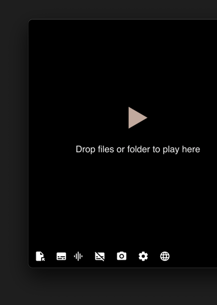

# About

Babel Player: A video player for English learners.

NOTICE: I'm hosting the binaries on GitHub. The player source code won't be uploaded until it's stable.

## Website source license

The original website source in this directory is licensed under the [MIT License](./LICENSE), copyright (c) 2026 Babel Player Team. Third-party assets retain their own licenses; see [the player icon font license](./assets/player-icons-LICENSE.txt). This license applies only to the website source, not the Babel Player application or its binaries.

## Website deployment

Production: https://babel-player.pages.dev

Install Node.js LTS, then run `npm ci`. Use `npm run build` to copy public files into `dist/`, `npm run preview` to preview with Cloudflare locally, and `npm run deploy` to publish the production deployment. Run `npx wrangler login` first when deploying from a new computer.

The build sets canonical, language, social preview, and sitemap URLs to the production origin declared in `build.mjs`. Development files and dependencies are excluded from the upload.

The Cloudflare Pages project uses Direct Upload and production branch `2026.10`. Git pushes do not deploy automatically. Project settings are in `wrangler.toml`; `deploy.mjs` selects the account, overridable with `CLOUDFLARE_ACCOUNT_ID`. Account IDs are public identifiers, not credentials.

Validation: `npm test` runs the existing website checks and deployment tests; `npm run test:build` runs deployment tests alone. `npm run format:check` checks deployment tooling formatting. There is no TypeScript compilation step.
